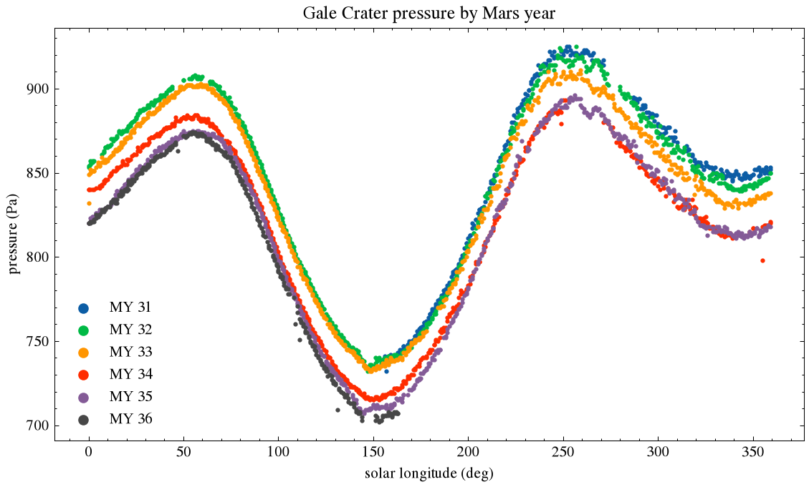
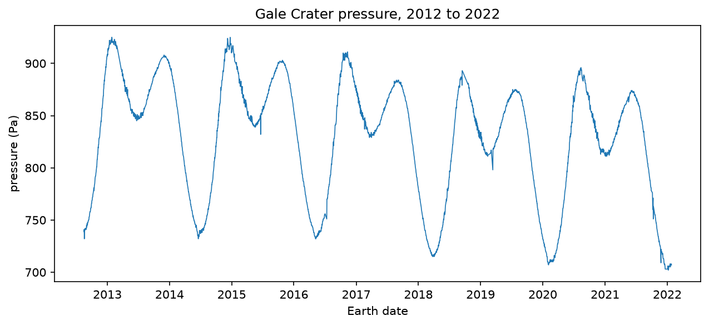
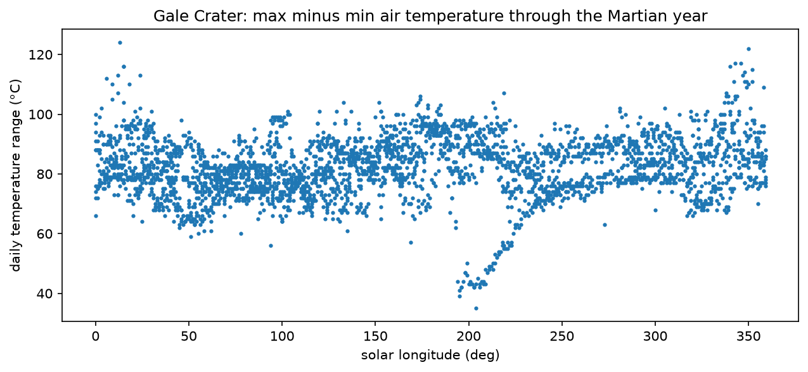
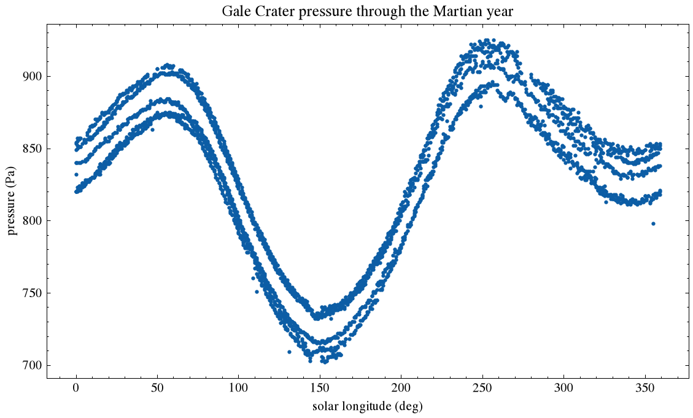

# Mars Weather at Gale Crater: Curiosity REMS Analysis

Analysis of ten years of daily weather from NASA's Curiosity rover (Gale Crater, Mars), covering August 2012 to January 2022. The project cleans a messy real-world sensor record, flags glitches with a rolling-median filter, and shows Mars's seasonal pressure cycle, the effect of the rover's climb up Mount Sharp, and the 2018 global dust storm.

**Stack:** Python · pandas · matplotlib · Jupyter (VS Code)

---

## Key findings

### 1. Mars "breathes" CO₂ through the year


Pressure at Gale Crater swings between about **700 and 925 Pa** every Martian year, a change of roughly 25–30%. Most of Mars's atmosphere is CO₂, and in polar winter it gets cold enough for that CO₂ to freeze onto the ice cap, taking gas out of the air.

- **Deepest minimum (Ls ≈ 150°):** southern winter. CO₂ freezes onto the large south polar cap.
- **Highest maximum (Ls ≈ 250°):** southern spring and summer. The south cap sublimates back into the air.
- **Smaller peak (Ls ≈ 50°):** the same process at the smaller north polar cap.

*TLDR:* Mars's pressure rises and falls because a large part of its CO₂ atmosphere freezes onto whichever pole is in winter and returns when it warms.

### 2. The rover's climb shows up in the pressure data


All six Mars years (MY 31–36) follow the same seasonal shape, but **later years sit lower** (MY 34–36 run about 20–30 Pa below MY 31–33). Curiosity has been driving up the slopes of Mount Sharp, and at higher elevation there is less atmosphere overhead, the same way pressure falls on an Earth mountain.

### 3. The 2018 global dust storm


Between **17 June and 25 July 2018 (sols 2084–2121, Ls 194–217°)** the daily temperature range collapsed from its usual ~80–90 °C to about **40–50 °C**. This is the planet-wide dust storm that also ended the Opportunity rover's mission. Dust blocked sunlight during the day (daily highs fell to around −15 °C) and trapped heat at night (lows stayed near −60 °C). The range then recovered gradually as the dust settled.

### 4. Seasonal pressure cycle (all years combined)


---

## Cleaning log

| Step | Sols | Notes |
|---|---|---|
| Loaded | 3,197 | Sol 10 to Sol 3368. Some sols have no record at all. |
| Dropped columns | n/a | `wind_speed` and `humidity` were 100% missing ("Value not available") |
| Dropped rows: missing core values | −29 | No temperature or pressure reading (<1% of rows) |
| After missing-value drop | 3,168 | |
| Flagged as sensor glitches | −50 | 40 `min_temp`, 6 `max_temp`, 7 `pressure` (some sols flagged in more than one column) |
| **Final clean dataset** | **3,118** | |

### How the data was prepared
- **Text to numbers.** Values arrived as text (`"Sol 3368"`, `"Earth, 2022-01-26 UTC"`, `"Mars, Month 6 - LS 163°"`). I extracted the sol, Earth date, Mars month and solar longitude (Ls) with regular expressions, and converted "Value not available" to `NaN`.
- **Sorting.** The file was sorted newest-first. I sorted by sol before any rolling calculation, because a rolling median only makes sense in time order.
- **Mars year.** I assigned a new Mars year each time Ls wraps from ~360° back to 0°, starting at MY 31 (the landing year).

### Why a rolling median, and why these thresholds
Weather changes gradually from one sol to the next, so a reading far from its neighbours is more likely a sensor glitch than real weather. For each sol I computed the **median of the surrounding 15 sols** (centred window, at least 5 valid values) and flagged readings that differ from it by more than:
- **15 °C** for `min_temp` and `max_temp`
- **20 Pa** for `pressure` (the daily pressure noise is only a few Pa, so 20 Pa is far outside normal variation)

I used a **median** rather than a mean because a single extreme glitch drags the mean toward itself but barely moves the median. I chose this rule-based approach over deleting points by eye so the cleaning is reproducible and every removal can be explained.

The filter did **not** remove the 2018 dust storm, even though those sols look unusual. The storm lasted weeks, so each sol's neighbours had shifted with it. The rolling median follows real multi-week events and only catches one-off spikes.

### Known limitations
- `ls` is rounded to whole degrees in this dataset, which causes visible vertical banding in the Ls charts.
- The 15 °C / 20 Pa thresholds are judgement calls. Tighter thresholds would flag more points but risk removing real short-lived weather.

---

## Data source

**Dataset used:** [MARS Rover Environmental Monitoring Station](https://www.kaggle.com/datasets/deepcontractor/mars-rover-environmental-monitoring-station) on Kaggle (Deep Contractor), a community copy of Curiosity's daily REMS weather summaries.

**Why not the live NASA feed:** the original source (`mars.nasa.gov/rss/api/?feed=weather&category=msl&feedtype=json`) was returning a server error instead of data when this project was built (November 2026). The mars.nasa.gov site is being retired, so I switched to a saved copy of the same data.

**Note on data quality:** these daily summaries come from NASA's public outreach feed and are not calibrated science data. The full, calibrated REMS record is archived in NASA's Planetary Data System at the [PDS Atmospheres Node](https://pds-atmospheres.nmsu.edu/data_and_services/atmospheres_data/MARS/curiosity/rems.html). A natural next step would be to repeat this analysis on the PDS data.

---

## How to run

```bash
python -m venv venv
venv\Scripts\activate            # Mac/Linux: source venv/bin/activate
pip install pandas matplotlib jupyter
```
Download the dataset CSV into the project folder, open `mars_weather.ipynb` and choose **Run All**.

---

## Possible extensions
- Apply the same analysis to the calibrated PDS REMS data.
- Model pressure against rover elevation to separate the climb effect from the seasonal cycle.
- Add the USGS Robbins Mars crater database and map crater density by latitude.
